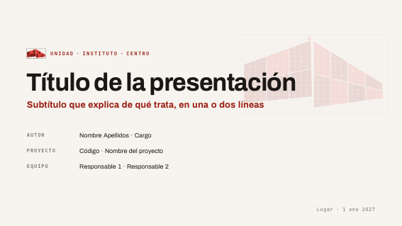
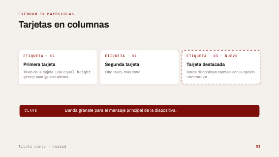
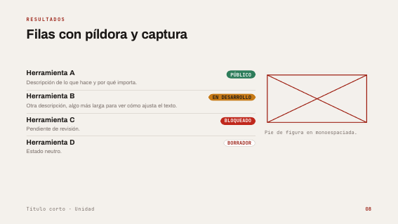
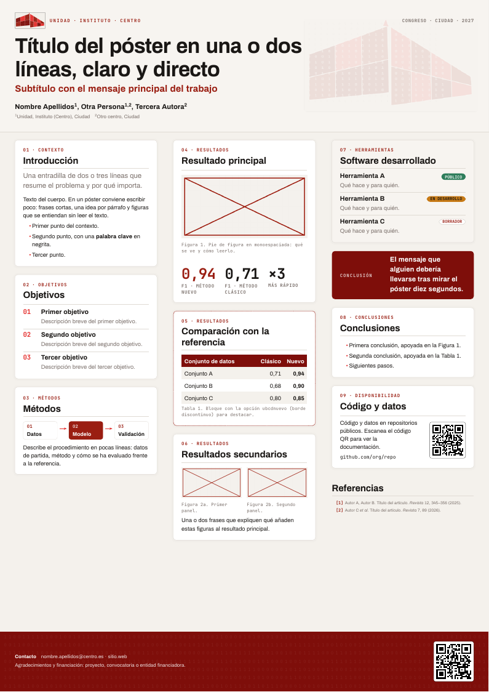

# UBCD Slides & Poster Template

A [Beamer](https://ctan.org/pkg/beamer) theme for XeLaTeX/LuaLaTeX, built on top of
[moloch](https://ctan.org/pkg/moloch), following the visual identity of the
**UBCD** (Unidad de Bioinformática y Ciencia de Datos, IBFG · CSIC-USAL).
Warm linen canvas, crimson accents, maroon section dividers with a binary-digit
field, and a small set of ready-made components (cards, numbered rows, stat
figures, status pills, step flows, captioned screenshots, tables).

The repo also ships a matching **scientific poster** package (`ubcdposter.sty`)
with the same colours, fonts and components, scaled for A0/A1/A2.

| Title page | Cards + band | Rows with pills |
|---|---|---|
|  |  |  |

<p align="center"></p>

## Repository layout

```
beamerthemeUBCDSlidesTemplate.sty   the slide theme
ubcdposter.sty                      the poster package (A0/A1/A2, portrait or landscape)
logos/                              UBCD marks used by the theme (light + maroon)
example/main.tex                    demo deck using every component
example/latexmkrc                   build config for the demo
starter/main.tex                    minimal blank deck to start a new talk
poster/main.tex                     example A0 poster (3 columns) using every poster component
docs/components.md                  reference for every command / environment
CLAUDE.md                           instructions for AI assistants editing decks
.github/workflows/build.yml         CI: builds the example deck and poster, uploads the PDFs
```

## Requirements

* A TeX distribution with **XeLaTeX** (or LuaLaTeX) and `latexmk` — TeX Live or MiKTeX.
* TeX packages: `beamer`, `moloch`, `tcolorbox`, `tikz`, `fontspec`, `babel`,
  `tabularx`, `colortbl`, `etoolbox`, `iftex`.
* Fonts, both distributed as TeX packages (OFL): **Archivo** (`archivo`) and
  **JetBrains Mono** (`jetbrainsmono-otf`). MiKTeX installs them on first use;
  on TeX Live: `tlmgr install archivo jetbrainsmono-otf moloch`.
* Poster only: `geometry`, `lmodern`, and optionally `qrcode` (for `\ubcdqr`).

With pdfLaTeX the theme falls back to the `Archivo` and `inconsolata` packages
(works, but XeLaTeX/LuaLaTeX is the supported path).

## Quick start

```bash
git clone https://github.com/<your-user>/ubcd-beamer-template.git
cd ubcd-beamer-template/example
latexmk main.tex          # -> main.pdf
```

To start a new talk, copy `starter/` somewhere (or inside this repo), edit
`main.tex`, and build with `latexmk`. The `latexmkrc` there already forces
XeLaTeX and points `TEXINPUTS` at the repo root so the theme and logos are found.

To use the theme in an unrelated project, copy
`beamerthemeUBCDSlidesTemplate.sty` and the two `logos/ubcd-mark-*.png` files next
to your `main.tex` and write `\usetheme{UBCDSlidesTemplate}`.

## Anatomy of a deck

```latex
\documentclass[aspectratio=169,t]{beamer}
\usetheme{UBCDSlidesTemplate}
\usepackage[spanish,es-noshorthands,es-nolayout]{babel}
\graphicspath{{../logos/}{logos/}{figures/}}

\title{...}  \subtitle{...}  \author{...}  \date{...}
\ubcdkicker{UNIT · INSTITUTE}      % label next to the logo
\ubcdfootertext{Short title}       % footer on every slide
\ubcdtitlemeta{\ubcdmetarow{KEY}{value}}

\begin{document}
\begin{frame}[plain]\titlepage\end{frame}
\ubcdsection{Section name}{One-line description shown on the divider}
\begin{frame}{Slide title}{EYEBROW}
  ...
\end{frame}
\ubcdclosing{Gracias}{¿Preguntas?}{contact · web}
\end{document}
```

See [docs/components.md](docs/components.md) for everything the theme provides.

## Posters

```bash
cd poster
latexmk main.tex          # -> main.pdf (A0 portrait)
```

```latex
\documentclass{article}
\usepackage[a0]{ubcdposter}        % a0 | a1 | a2, add ",landscape"
\title{...} \subtitle{...} \author{A\textsuperscript{1}, B\textsuperscript{2}}
\ubcdaffiliation{...} \ubcdkicker{...} \ubcdevent{CONGRESS · CITY · 2027}

\begin{document}
\ubcdposterheader
\begin{ubcdcolumn}{0.31}
  \begin{ubcdblock}{01 · CONTEXT}{Introduction} ... \end{ubcdblock}
\end{ubcdcolumn}\hfill
\begin{ubcdcolumn}{0.31} ... \end{ubcdcolumn}\hfill
\begin{ubcdcolumn}{0.31} ... \end{ubcdcolumn}
\ubcdposterfooter{contact · acknowledgements}{\ubcdqr{https://...}}
\end{document}
```

All sizes are designed for A0 and scale automatically with the paper option,
so the same source prints at A1 or A2 without edits. For landscape, use four
columns of `0.235`. The poster must fit on one page: if the footer moves to
page 2, trim text or shrink figures.

## Design notes

* The design is a 1920×1080 px canvas; **1 px = 0.237 pt** (16:9 = 455 × 256 pt),
  so all sizes in the `.sty` map 1:1 onto the HTML version of the design system.
* Colours are tokens (`ubcdCrimson`, `ubcdMaroon`, `ubcdLinen`, …) defined at the
  top of the `.sty`; change them there to re-skin the whole theme.
* Section dividers are generated automatically by `\ubcdsection{Title}{Description}`.
  The language of the divider label is set with `\ubcdsectionlabel{SECCIÓN}`.
* Speaker notes: put `\note{...}` inside each frame and uncomment
  `\setbeameroption{show notes on second screen=right}` to preview them.

## Licence

Code (both `.sty` files, example, starter and poster files, docs): MIT — see [LICENSE](LICENSE).
The UBCD logo marks in `logos/` are **not** covered by the MIT licence; they are
the property of the UBCD/IBFG. Replace them (`\ubcdlogo{...}`, `\ubcdlogodark{...}`)
if you reuse the theme for another organisation. Funding/institutional logos
(Red.es, Generación D, EU-NextGenerationEU, CSIC) are deliberately **not**
included; follow each funder's communication manual when adding them.